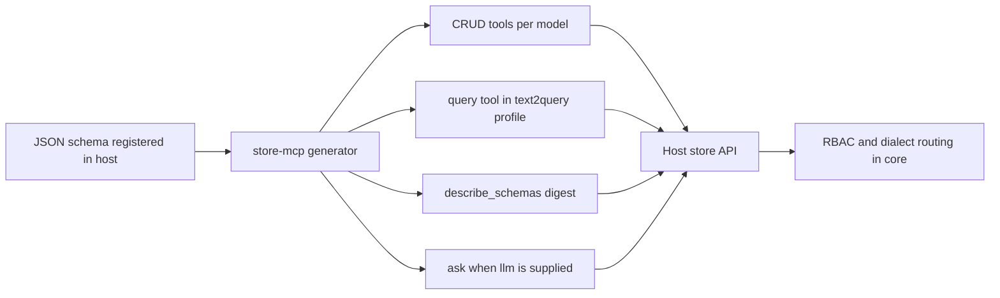

# store-mcp

**Auto-generates an MCP tool surface from the JSON schemas already registered in a common-store host — one tool per verb per model, zero hand-written handlers, and every data call still judged by the same GQL, RBAC and profile rules as REST, GraphQL and gRPC.**

[](https://www.npmjs.com/package/store-mcp-node)
[](https://pypi.org/project/store-mcp-py/)
[](https://github.com/coenddt/store-mcp/blob/main/LICENSE)

- `store-mcp-node` **0.4.3** on npm — Node **>= 18**, carrier `@modelcontextprotocol/sdk` (`^1.31.0`).
- `store-mcp-py` **0.4.3** on PyPI — Python **>= 3.10**, carrier `mcp>=2.2,<3`.
- Both speak **stdio** and **streamable HTTP**, and both expose the identical tool surface.

中文: [README.md](./README.md)

## The Friday question that has no endpoint

Suppose an analyst opens an AI assistant at 16:50 on a Friday and asks: "which orders above 10,000 are still unpaid this quarter, and who owns them?" The assistant has no database driver, no connection string and no REST client. The data does exist — twelve models registered in a common-store host, each with fields, relations and computed columns.

The usual answer is to let the model improvise. It writes a SQL string from memory: it guesses `orders` instead of `Order`, invents `paid_at`, forgets the tenant filter, and the request either fails or, worse, succeeds with the wrong rows. The other usual answer is manual: someone hand-writes five tools per model — twelve models times five verbs is sixty handlers, plus two global ones — and then maintains that list every time a field is added.

The schema already knows all of this. It knows the model names, the `idField`, the computable columns, the hidden models and the archive tables. **The missing piece is not knowledge; it is exposure.** This adapter exposes that knowledge as MCP tools, computed at boot, and routes each call back through the store API that already enforces permissions and dialect rules.

## What it actually does

It reads `store.list()` plus each model's definition from the host, emits the tool list, and maps every invocation onto the host's existing public methods. Nothing is re-declared, and core and hosts are untouched.

| It owns | It deliberately does not own |
|---|---|
| Tool generation from the registered schema | Schema definition — the host owns it |
| Input → GQL + params → host API mapping | GQL parsing, RBAC, computed columns, dialect routing — core owns them |
| MCP error envelope mapping | Retry and fallback policy — the host `ask()` owns it |
| stdio and streamable HTTP carriers | Authentication and sessions — put a reverse proxy or `ctxFromRequest` in front |

For each model `X`, five tools are generated. Two globals always exist, and one more is opt-in:

| Tool | Input schema | What the argument means |
|---|---|---|
| `get_X` | `{ id: string }` *(required)* | Exact single-row lookup by the model's `idField` |
| `list_X` | `{ q?: string, params?: object }` | `q` is the GQL suffix starting at the model name; `params` is the native JSON parameter object |
| `create_X` | `{ body: object }` *(required)* | Insert one document |
| `update_X` | `{ id: string, set: object }` *(both required)* | Partial update located by `idField` |
| `delete_X` | `{ id: string }` *(required)* | Delete located by `idField` |
| `query` | `{ gql: string, params?: object }` | Arbitrary read, forced into the host's `text2query` profile |
| `describe_schemas` | `{}` | Permission-filtered digest of models, fields, relations and computed columns |
| `ask` | `{ question: string }` *(required)* | Natural-language question, registered only when `opts.llm` is supplied |

For a model named `User`, those names are literally `get_User`, `list_User`, `create_User`, `update_User` and `delete_User`.

Tool names use the model name verbatim — `get_User`, `list_Order` — with no case rewriting and therefore no service-name collision. If a definition carries `x-mcp: { hidden: true }`, no tool is generated for it; digest visibility remains the host's decision, governed by the same read permissions.

## How it works

### One schema in, a countable surface out

Generation is a pure function of the registered definitions: archive filtering, projection, `idField` and naming all come from them.

- A model whose name ends in `Deleted` is skipped **only if** the same name without the suffix also exists. A genuinely standalone `StandaloneDeleted` model survives.
- `get_X` always uses the schema projection `{ field1, field2, ... }`, built from `fields` plus `computes`. `list_X` uses the same projection only when `q` is empty; when `q` is present, the projection is whatever `q` says.
- `idField` defaults to `_id`; the locator value is passed through untouched, with no type rewriting.
- `describe_schemas` proxies the host's `describe_for_ai`. With a trusted context it returns the full digest; without one it returns the host's degraded digest — model names and field names only, an anti-probe measure.

The same builder backs `exportTools()` / `export_tools()` and the running server, so a CI assertion about the tool list cannot drift from what a client sees.

### The inputs are the GQL you would have written

There is no second query language and no hidden ORM. Each handler parses its arguments, calls one host method, and returns the result as JSON.

| Call | Host call |
|---|---|
| `get_User` with `{ id: "u1" }` | `store.queryOne('User($condition: @c0) { name, full }', { c0: { _id: 'u1' } })` |
| `list_User` with no `q` | `store.query('User { name, full }', undefined)` |
| `list_User` with `q` | `store.query('User' + q, params)` |
| `create_User` | `store.insert('User', body)` |
| `update_User` | `store.update('User', { _id: id }, set)` |
| `delete_User` | `store.remove('User', { _id: id })` |
| `query` | `store.query(gql, params)` inside the `text2query` profile, with `routeOverride` hard-coded to `null` |
| `describe_schemas` | `store.describeForAi(ctx)` |

Two details matter. First, `params` is a native MCP object — no `_json` string encoding, unlike protocol-buffer-based skins. Second, `query` is not a privileged escape hatch: it runs inside the host's read-only `text2query` sandbox, whose core limits are **1,000 rows, depth 3, and no `route_override`**. The adapter supplies no context for it either; core rejects a missing context rather than forging one.

`ask` is registered only when `opts.llm` is provided, and providing `llm` without a context — and without an HTTP request hook — fails at assembly time. The handler does exactly three things: read `question`, call the host's `ask()`, return `{ data, attempts, events }`. Translation, validation, retry and feedback all live in the host, so there are never two competing retry policies.

### RBAC and the three states a caller can be in

Every data tool call passes through core's four judgments — syntax, profile, permission and hard limits — because it is the same call the other skins make. The adapter never widens access. It only classifies the outcome:

| State | Wire response | Code |
|---|---|---|
| **Success** | `content[0].text` is the JSON payload; no error key exists | — |
| **Miss** | `isError: true` with a deterministic message such as `User u1 not found` | `notFound` |
| **Denied** | `isError: true`; the host's permission exception text is passed through verbatim | `permissionDenied` |

The three states are deliberately distinct: a missing row is neither a success with an empty object nor a crash, and a permission failure keeps the original wording instead of being rewrapped into a generic "forbidden". Behind those three sit the rest of a fixed judgment chain: a `ProfileViolation` becomes `profileBlocked`; a missing required context becomes `noContext`; an argument that is an array, a scalar or an empty string becomes `invalidParam` or `invalidBody`; exhausted `ask` retries become `askExhausted`; anything else becomes `planError`.

Core's stable prefixes — `ERR_GQL_PARSE:`, `ERR_TEXT2QUERY:`, `ERR_LIMIT:` — are preserved verbatim inside `message`, never summarized or stripped. Detection is by exception name or machine code rather than `instanceof`, so it stays correct across package boundaries.

### Two carriers, two transport lifetimes

Both runtimes expose the same surface; only the lifetime of the transport differs.

- **stdio** is the simplest deployment: the MCP client spawns the process and speaks over stdin/stdout.
- **streamable HTTP** listens on `127.0.0.1:8635` at `/mcp` by default. Node uses `node:http` plus the SDK's `StreamableHTTPServerTransport`, with no web framework. Python serves the SDK's ASGI transport through `uvicorn`.
- Node builds a **fresh transport and server per request**, because that SDK forbids reusing a stateless transport; Python keeps **one transport and server** and swaps the context per request, because its SDK stores initialize state on the connection.
- `ctx` and `ctxFromRequest` / `ctx_from_request` are mutually exclusive — supplying both throws at assembly instead of silently picking one. On Node, an occupied port rethrows the native `EADDRINUSE`; a non-endpoint path returns a structured 404; a failing identity hook returns a structured 500.
- There is **no built-in authentication and no session management**. GET and DELETE go to the SDK as-is. Put a reverse proxy or an identity-decoding hook in front.

## Run it

```bash
npm install store-mcp-node
pip install store-mcp-py
```

Both adapters expect a host with registered schemas: `nodejs-store` for the Node runtime, `py-store` for Python. The host is an optional peer dependency — `exportTools` / `export_tools` work without it.

A working stdio entry from [`node/example/dsh-stdio-server.js`](https://github.com/coenddt/store-mcp/blob/main/node/example/dsh-stdio-server.js), reduced to its four steps:

```javascript
const fs = require('node:fs');
const { init, store, schema, local } = require('nodejs-store');
const { createStdioServer } = require('store-mcp-node');

async function main() {
  // 1. data source: local disk backend, no Mongo needed
  await init(local.connect({ dir: process.env.STORE_LOCAL_DIR }));

  // 2. register the plain JSON schema
  for (const defn of JSON.parse(fs.readFileSync(process.env.STORE_SCHEMA, 'utf8'))) {
    schema.register(defn);
  }

  // 3. trusted server-side context; never visible to the client
  const ctx = { userId: 'ai-reader', roles: ['viewer'] };
  store.setContext(ctx);

  // 4. block on stdio; omit llm, so ask is not registered
  await createStdioServer(store, { name: 'store-mcp', ctx });
}

main().catch((e) => { console.error(e); process.exit(1); });
```

For streamable HTTP in Python, the same store and guards, using the pattern exercised in [`py/tests/test_http_server.py`](https://github.com/coenddt/store-mcp/blob/main/py/tests/test_http_server.py):

```python
import anyio
from store_mcp import run_http

# store: an initialized py-store instance with schemas registered

async def main():
    async with anyio.create_task_group() as tg:
        tg.start_soon(run_http, store, {
            "port": 8635,
            "endpoint": "/mcp",
            "ctx": {"userId": "ai-reader", "roles": ["viewer"]},
        })
        # the MCP client connects to http://127.0.0.1:8635/mcp

anyio.run(main)
```

Python's `run_http` blocks until cancelled, so it belongs in a task group or a dedicated process. If you only want the definitions — no SDK, no listener, no side effects — call `exportTools(store, opts)` (Node) or `export_tools(store, opts)` (Python).

## Boundaries: when not to use it

- **You need MCP resources or prompts.** This adapter exposes tools only. There are no resource URIs and no prompt templates.
- **You need a custom tool surface that is not your schema.** Generation is always schema-driven. Tool-level override or extend annotations are not supported; the only annotation is the model-level `x-mcp.hidden`.
- **Your queries are bulk exports or long analytical scans.** The `query` tool inherits the `text2query` sandbox — 1,000 rows, depth 3, no route override. That ceiling is intentional for an untrusted caller.
- **You want the adapter to authenticate callers.** It ships no auth, no session store and no rate limiting. HTTP deployments need a proxy or an identity hook in front, and stdio deployments are single-user by nature.
- **You have no registered schema.** Without a host that can list and describe its models, there is nothing to generate; this is not a database driver.

## Where it sits in the family

It is the fourth protocol skin over the same single JSON-schema source — after REST ([store-api](https://github.com/coenddt/store-api)), GraphQL ([store-graphql](https://github.com/coenddt/store-graphql)) and gRPC ([store-grpc](https://github.com/coenddt/store-grpc)) — generating from the host you already run, [nodejs-store](https://github.com/coenddt/nodejs-store) or [py-store](https://github.com/coenddt/py-store), with [store-gateway](https://github.com/coenddt/store-gateway) as the combiner, [rust-store](https://github.com/coenddt/rust-store) as the core, [meta-store](https://github.com/coenddt/meta-store) as the control plane and [create-store-app](https://github.com/coenddt/create-store-app) as the scaffold.

## The whole picture



One schema, five verbs per model, two global tools, and no second definition to keep in sync.
