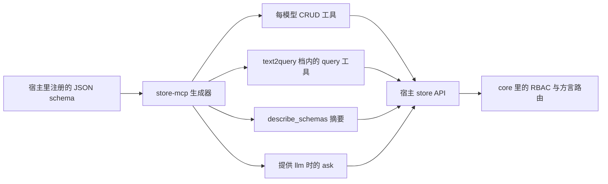

# store-mcp

**把 common-store 宿主里已注册的 JSON schema 自动变成 MCP 工具面——每个模型每个动词一个工具，零手写 handler。每一次数据调用，仍然由 REST、GraphQL、gRPC 共用的同一套 GQL、RBAC 与档位规则裁决。**

[](https://www.npmjs.com/package/store-mcp-node)
[](https://pypi.org/project/store-mcp-py/)
[](https://github.com/coenddt/store-mcp/blob/main/LICENSE)

- `store-mcp-node` **0.4.3**（npm）—— Node **>= 18**，承载 `@modelcontextprotocol/sdk`（`^1.31.0`）。
- `store-mcp-py` **0.4.3**（PyPI）—— Python **>= 3.10**，承载 `mcp>=2.2,<3`。
- 两者都支持 **stdio** 与 **streamable HTTP**，并暴露完全相同的工具面。

中文索引（本页） · English: [README.md](./README.md)

## 周五那个没有端点的提问

周五 16:50，分析师打开 AI 助手问：「本季度一万以上还没付款的订单有哪些，分别归谁？」

助手没有数据库驱动、没有连接串、没有 REST 客户端。数据其实都在——common-store 宿主里注册了 12 个模型，每个都有字段、关系和计算列。

常见的做法是让模型即兴发挥。它凭记忆写 SQL：把 `Order` 猜成 `orders`，编出一个 `paid_at`，忘了租户过滤。请求要么失败，要么更糟——成功返回了错的行。另一种常见做法是手工：每个模型手写五个工具，12 个模型乘 5 个动词就是 60 个 handler，再加两个全局工具，然后每次加字段都维护这份清单。

schema 早就知道这一切。它知道模型名、`idField`、可计算列、隐藏模型和归档表。**缺的不是知识，是暴露。** 这个适配器把那份知识变成 MCP 工具，在启动时算好，再把每次调用送回已经在执行权限与方言规则的 store API。

## 它到底做什么

它读 `store.list()` 和每个模型在宿主里的定义，生成工具清单，把每次调用映射到宿主已有的公开方法。不重复声明任何东西，core 与宿主零改动。

| 它负责 | 它刻意不负责 |
|---|---|
| 从已注册 schema 生成工具 | schema 定义——归宿主 |
| 入参 → GQL + params → 宿主 API 的映射 | GQL 解析、RBAC、计算列、方言路由——归 core |
| MCP 错误信封映射 | 重试与兜底策略——归宿主 `ask()` |
| stdio 与 streamable HTTP 承载 | 认证与会话——请在前面放反向代理或 `ctxFromRequest` |

对每个模型 `X`，生成五个工具。两个全局工具始终存在，还有一个按需启用：

| 工具 | 入参 schema | 参数含义 |
|---|---|---|
| `get_X` | `{ id: string }` *(必填)* | 按模型 `idField` 精确查单行 |
| `list_X` | `{ q?: string, params?: object }` | `q` 是从模型名开始的 GQL 余部；`params` 是原生 JSON 参数对象 |
| `create_X` | `{ body: object }` *(必填)* | 插入一个文档 |
| `update_X` | `{ id: string, set: object }` *(都必填)* | 按 `idField` 定位后部分更新 |
| `delete_X` | `{ id: string }` *(必填)* | 按 `idField` 定位删除 |
| `query` | `{ gql: string, params?: object }` | 任意读，强制走宿主的 `text2query` 档 |
| `describe_schemas` | `{}` | 权限过滤后的模型、字段、关系、计算列摘要 |
| `ask` | `{ question: string }` *(必填)* | 自然语言提问，只在提供 `opts.llm` 时注册 |

模型叫 `User`，工具名就字面是 `get_User`、`list_User`、`create_User`、`update_User`、`delete_User`。

工具名原样使用模型名——`get_User`、`list_Order`——不做大小写改写，因此没有 service 名冲突。定义里带 `x-mcp: { hidden: true }` 就不为它生成工具；摘要里能看到什么仍由宿主决定，受同一套读权限约束。

## 它怎么工作

### 一份 schema 进，一个可数的面出

生成是已注册定义的纯函数：归档过滤、投影、`idField`、命名，全部来自定义本身。

- 名字以 `Deleted` 结尾的模型**仅在**去掉后缀的同名模型也存在时才跳过。真正独立的 `StandaloneDeleted` 会保留。
- `get_X` 恒用 schema 投影 `{ field1, field2, ... }`，由 `fields` 加 `computes` 构成。`list_X` 只在 `q` 为空时用同一投影；`q` 存在时，投影完全由 `q` 决定。
- `idField` 缺省 `_id`；定位值原样透传，不做类型改写。
- `describe_schemas` 代理宿主的 `describe_for_ai`。有受信上下文时返回完整摘要；没有时返回宿主的降级摘要——只有模型名和字段名，这是反探测措施。

同一个 builder 同时支撑 `exportTools()` / `export_tools()` 与运行中的 server，所以 CI 对工具清单的断言不会和客户端看到的漂移。

### 入参就是你本来要写的那段 GQL

没有第二套查询语言，也没有隐藏的 ORM。每个 handler 解析参数、调一个宿主方法、把结果按 JSON 返回。

| 调用 | 宿主调用 |
|---|---|
| `get_User`，`{ id: "u1" }` | `store.queryOne('User($condition: @c0) { name, full }', { c0: { _id: 'u1' } })` |
| `list_User`，无 `q` | `store.query('User { name, full }', undefined)` |
| `list_User`，有 `q` | `store.query('User' + q, params)` |
| `create_User` | `store.insert('User', body)` |
| `update_User` | `store.update('User', { _id: id }, set)` |
| `delete_User` | `store.remove('User', { _id: id })` |
| `query` | `store.query(gql, params)`，包在 `text2query` 档内，`routeOverride` 硬编码为 `null` |
| `describe_schemas` | `store.describeForAi(ctx)` |

两个细节值得记住。第一，`params` 是原生 MCP 对象——不像基于 protobuf 的皮肤那样需要 `_json` 字符串编码。第二，`query` 不是特权后门：它跑在宿主只读的 `text2query` 沙箱里，core 硬限 **1000 行、深度 3、禁 `route_override`**。适配器也不为它提供上下文；core 会拒绝缺失上下文，而不是伪造一个。

`ask` 只在提供 `opts.llm` 时注册；给了 `llm` 却没有上下文、也没有 HTTP 请求钩子，装配期就失败。handler 只做三件事：读 `question`，调宿主 `ask()`，返回 `{ data, attempts, events }`。翻译、校验、重试、反馈全在宿主，所以永远不会出现两套互相竞争的重试策略。

### RBAC 与调用方可能处于的三种状态

每次数据工具调用都经过 core 的四道判定——语法、档位、权限、硬限——因为它就是其他皮肤发出的同一次调用。适配器从不放大权限，只对结果分类：

| 状态 | 线上响应 | code |
|---|---|---|
| **成功** | `content[0].text` 是 JSON 载荷；不存在 error 键 | — |
| **未命中** | `isError: true`，message 形如 `User u1 not found` | `notFound` |
| **被拒绝** | `isError: true`；宿主权限异常文本原样透传 | `permissionDenied` |

这三种状态刻意分开：行不存在既不是「成功但返回空对象」，也不是崩溃；权限失败保留原始措辞，不重包装成泛泛的 forbidden。三种状态之后还有一条固定判定链：`ProfileViolation` 变成 `profileBlocked`；缺必填上下文变成 `noContext`；参数是数组、标量或空串变成 `invalidParam` 或 `invalidBody`；`ask` 重试耗尽变成 `askExhausted`；其余变成 `planError`。

core 的稳定前缀——`ERR_GQL_PARSE:`、`ERR_TEXT2QUERY:`、`ERR_LIMIT:`——原样保留在 `message` 里，绝不摘要或剥离。判定按异常名或机器码，而不是 `instanceof`，所以跨包边界依然正确。

### 两种承载，两种传输生命周期

两个运行时暴露同一个面，差别只在传输的生命周期。

- **stdio** 是最简部署：MCP 客户端拉起进程，通过 stdin/stdout 对话。
- **streamable HTTP** 缺省监听 `127.0.0.1:8635` 的 `/mcp`。Node 用 `node:http` 加 SDK 的 `StreamableHTTPServerTransport`，不引 Web 框架。Python 用 `uvicorn` 承载 SDK 的 ASGI transport。
- Node **每请求新建 transport 与 server**，因为该 SDK 禁止复用无状态 transport；Python 保持**一个 transport 与 server**，逐请求替换上下文，因为它的 SDK 把初始化状态存在连接上。
- `ctx` 与 `ctxFromRequest` / `ctx_from_request` 互斥——两个都给会在装配期抛错，而不是悄悄选一个。Node 上端口被占会重抛原生 `EADDRINUSE`；非端点路径返回结构化 404；身份钩子失败返回结构化 500。
- **没有内置认证，也没有会话管理**。GET 与 DELETE 原样交给 SDK。请在前面放反向代理或身份解码钩子。

## 跑起来

```bash
npm install store-mcp-node
pip install store-mcp-py
```

两个适配器都期待一个注册了 schema 的宿主：Node 用 `nodejs-store`，Python 用 `py-store`。宿主是 optional peer 依赖——`exportTools` / `export_tools` 没有它也能工作。

一个可用的 stdio 入口，取自 [`node/example/dsh-stdio-server.js`](https://github.com/coenddt/store-mcp/blob/main/node/example/dsh-stdio-server.js)，压成四步：

```javascript
const fs = require('node:fs');
const { init, store, schema, local } = require('nodejs-store');
const { createStdioServer } = require('store-mcp-node');

async function main() {
  // 1. 数据源：本地磁盘后端，不需要 Mongo
  await init(local.connect({ dir: process.env.STORE_LOCAL_DIR }));

  // 2. 注册纯 JSON schema
  for (const defn of JSON.parse(fs.readFileSync(process.env.STORE_SCHEMA, 'utf8'))) {
    schema.register(defn);
  }

  // 3. 服务端受信上下文，永不对客户端可见
  const ctx = { userId: 'ai-reader', roles: ['viewer'] };
  store.setContext(ctx);

  // 4. 阻塞在 stdio；省略 llm，所以不注册 ask
  await createStdioServer(store, { name: 'store-mcp', ctx });
}

main().catch((e) => { console.error(e); process.exit(1); });
```

Python 的 streamable HTTP，用同一份 store 与守卫，模式取自 [`py/tests/test_http_server.py`](https://github.com/coenddt/store-mcp/blob/main/py/tests/test_http_server.py)：

```python
import anyio
from store_mcp import run_http

# store: 一个已初始化、已注册 schema 的 py-store 实例

async def main():
    async with anyio.create_task_group() as tg:
        tg.start_soon(run_http, store, {
            "port": 8635,
            "endpoint": "/mcp",
            "ctx": {"userId": "ai-reader", "roles": ["viewer"]},
        })
        # MCP 客户端连接 http://127.0.0.1:8635/mcp

anyio.run(main)
```

Python 的 `run_http` 会一直阻塞到被取消，所以它属于 task group 或独立进程。只想要定义——不要 SDK、不要监听、不要副作用——就调 `exportTools(store, opts)`（Node）或 `export_tools(store, opts)`（Python）。

## 边界：什么时候不要用它

- **需要 MCP resources 或 prompts。** 这个适配器只暴露工具。没有 resource URI，也没有 prompt 模板。
- **需要一套不是 schema 形状的自定义工具面。** 生成永远由 schema 驱动。不支持工具级 override / extend 注记；唯一的注记是模型级 `x-mcp.hidden`。
- **查询是批量导出或长分析扫描。** `query` 工具继承 `text2query` 沙箱——1000 行、深度 3、禁 route override。这个上限是给不可信调用方刻意设的。
- **想让适配器认证调用方。** 它不带认证、不带会话存储、不限流。HTTP 部署需要前置代理或身份钩子；stdio 部署天然是单用户。
- **没有已注册的 schema。** 宿主列不出、也描述不了模型，就没有东西可生成。它不是数据库驱动。

## 在家族里的位置

它是同一份 JSON schema 事实源之上的第四层协议皮——排在 REST（[store-api](https://github.com/coenddt/store-api)）、GraphQL（[store-graphql](https://github.com/coenddt/store-graphql)）、gRPC（[store-grpc](https://github.com/coenddt/store-grpc)）之后——从你已经在跑的宿主生成：[nodejs-store](https://github.com/coenddt/nodejs-store) 或 [py-store](https://github.com/coenddt/py-store)。[store-gateway](https://github.com/coenddt/store-gateway) 是组合器，[rust-store](https://github.com/coenddt/rust-store) 是内核，[meta-store](https://github.com/coenddt/meta-store) 是控制面，[create-store-app](https://github.com/coenddt/create-store-app) 是脚手架。

## 整张图



一句话收束：一份 schema，每模型五个动词，两个全局工具，没有第二份要同步的定义。

MIT —— 见 [LICENSE](./LICENSE)。
